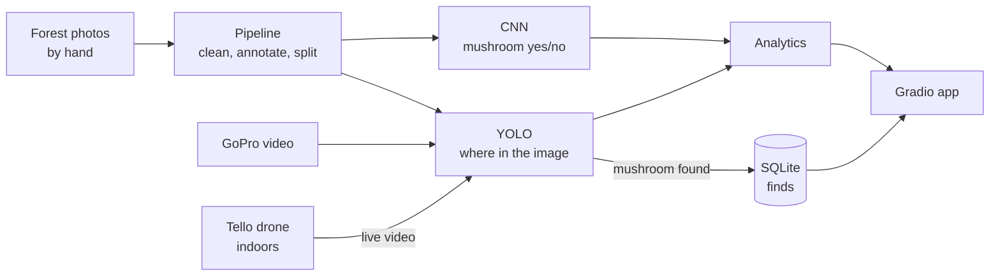

# Craterellus 🍄

**The idea:** a drone flies over the forest, finds **suppilovahvero** (*Craterellus tubaeformis*), and saves where and when, building a **map of where mushrooms grow**.

**Why a drone:** searching on foot tramples the forest floor. A drone touches nothing and covers more ground.

**Who could use it:** researchers (density per km², species maps), forest-health monitoring, rare-species surveys, foragers.

**What we actually build:** a student prototype. Flying outdoors needs a licence, so:
- **Data:** photos and GoPro video are taken **by hand** at drone-like heights.
- **Drone:** a **Ryze Tello** flies **indoors only**, over a terrarium, and streams live to the laptop, which shows detections in real time.

More detail in [docs/ARCHITECTURE.md](docs/ARCHITECTURE.md) and [docs/drone.md](docs/drone.md).

## How it works



## Stack

| What | Tool |
|---|---|
| Language | Python 3.12 + uv |
| Annotation | CVAT |
| CNN | TensorFlow / Keras |
| Detection | Ultralytics YOLOv5 + ByteTrack + SAHI |
| Drone | Ryze Tello + `djitellopy` |
| Finds log | SQLite |
| App | Gradio |

## Setup

```bash
curl -LsSf https://astral.sh/uv/install.sh | sh     # install uv
git clone https://github.com/Sairanyx/craterellus.git
cd craterellus && uv sync                            # install everything
uv run app/panel.py                                  # Gradio app
uv run src/tello_fly.py                              # fly the Tello (laptop on Tello Wi-Fi)
```
- **New package:** `uv add <name>`, then commit `pyproject.toml` and `uv.lock`.
- **Data and models:** these are **not in git**. They're on the shared drive.

## Steps

1. ✅ **Collect:** 397 photos from 2 iPhones (~350 with mushrooms, ~48 without), plus 4 GoPro videos.
2. **Pipeline (M1):** HEIC → JPG, boxes in CVAT, split by patch.
3. **CNN (M2):** baseline on whole photos → high bias (mushrooms too small) → **tiles** → Dropout/L2 → callbacks → test Acc/P/R.
4. **YOLO (M3):** fine-tune YOLOv5 → boxes on test photos.
5. **Extras:** Grad-CAM, SAHI, ByteTrack mushroom count.
6. **Demos:** test photos → GoPro video → live Tello over the terrarium.
7. **Gradio app:** one tab per demo, plus metrics and finds.

## Demo realities

- **Videos are test only:** we train on photos only. The model runs on each video frame.
- **Terrarium:** 1 m × 1 m, with real moss, needles, mushrooms and lookalikes, lit by bright LEDs. Press the moss down so the propeller wind doesn't move it.
- **Tello camera:** worse than a phone and points forward. Fly back and up, and train with blur and noise. Test early.
- **Mushrooms for demo day:** pick fresh or buy fresh (not frozen or dried). Record a backup flight in late November.

## Saving finds

Each live detection is saved as one SQLite row; the snapshot is stored as a file.

```sql
CREATE TABLE finds (id INTEGER PRIMARY KEY, time TEXT, lat REAL, lon REAL,
                    confidence REAL, image_path TEXT);
```
Indoors there's no GPS, so the demo uses a fixed position. A real drone would use its own GPS.
