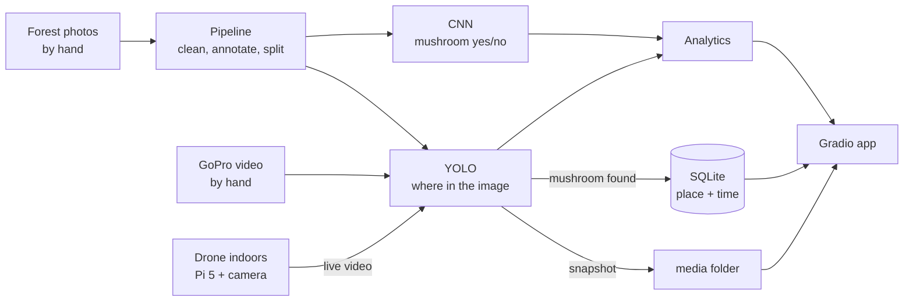

# Craterellus 🍄

**The idea:** a drone flies over the forest and finds **suppilovahvero** (*Craterellus tubaeformis*, funnel chanterelle).
Every find is saved with its location and time, which builds a **map of where mushrooms grow**.

**Why a drone:** people searching on foot trample moss, plants and young mushrooms.
A drone surveys from the air, so **nothing on the ground is touched**. It also covers more area, faster.

**Who could use it:**
- **Researchers:** mushroom density per km², species maps, and changes from year to year.
- **Forest health:** mushrooms live with tree roots, so they show how healthy the soil is.
- **Rare or protected species:** finding and monitoring them without disturbing them.
- **Foragers and harvest businesses:** knowing where to go.

**What we actually build:** flying outdoors needs a drone licence, so this is a student prototype of that idea.
- **Photos and video:** we take them **by hand**, holding the phone or GoPro at drone-like heights and angles.
- **The drone:** we only fly it **indoors**, over a **terrarium** with moss and real mushrooms, on demo day.
  A Raspberry Pi 5 camera on it streams live, and the laptop shows the detections in real time.
- **Hardware:** we borrow the drone and the Pi 5 from the AIS lab.

More detail in [ARCHITECTURE.md](ARCHITECTURE.md).

## How it works



## Stack

| What | Tool |
|---|---|
| Language | Python 3.12 |
| Annotation | CVAT |
| CNN | TensorFlow / Keras |
| Detection | Ultralytics YOLOv5 + ByteTrack |
| Drone (indoor demo) | AIS lab drone + Raspberry Pi 5 + Pi camera |
| Records | SQLite (one file) |
| Images / videos | files in `media/`, path saved in SQLite |
| App | Gradio |

## Steps

1. **Collect photos (by hand).** In the forest, each person takes about 50 photos with mushrooms and 6 without.
   We copy drone views: 2 m at 45°, 1 m from above, and ground level.
   Name files with your initials: `ED_0001.jpg`.
2. **Pipeline.** Fix format and rotation, draw boxes in CVAT, and split into train/val/test by location (**M1**).
3. **CNN.** Train a simple model that answers yes/no, find what's wrong with it, fix it, and test it (**M2**).
4. **YOLO.** Fine-tune YOLOv5 to draw boxes around each mushroom (**M3**).
5. **Analytics.** Accuracy and other metrics, training charts, what the CNN looks at (Grad-CAM), and mushroom counts.
6. **Testing.** Run both models on photos they have never seen.
7. **Demos:**
   1. **Images:** upload a photo and see the result.
   2. **GoPro video:** a forest walk filmed by hand on a pole, with boxes and a count of mushrooms.
   3. **Live drone:** indoors over the terrarium, with boxes in real time.
8. **Gradio app.** One page with a tab for each demo, the metrics, and a map of finds.
9. **Terrarium.** Build it and bring it to demo day.

## Demo realities

**Videos are only for testing.** We train on photos only. A video is just many photos in a row, so the same model runs on every frame.
The GoPro video and the drone stream are **never used for training**.

**Terrarium (1 m × 1 m) = a small forest.**
- **Materials:** real moss, needles, cones and yellow leaves from the same forests.
- **Mushrooms:** real suppilovahvero plus lookalikes as negatives.
- **Light:** bright daylight LEDs.
- **Flying:** close to the biggest mushrooms. Press the moss down so the propeller wind doesn't blow things around.

**Pi camera vs phone photos.** The model learns from good phone photos, and the Pi camera is worse.
- Ask the AIS lab for **Camera Module 3**, which has autofocus. v1/v2 are blurry closer than about 50 cm.
- Stream at **1280×720**, not 640×480.
- Train with extra **blur, noise and downscaling**, so the model is used to bad images.
- **Test early:** point the Pi camera at a mushroom on a table. If confidence is low, add 20–30 Pi photos (not of the terrarium) to training.

**Getting mushrooms for demo day (early December).**
1. **Pick in the forest:** extra during collection week, and again in late November if there's no snow. The season often lasts into November.
2. **Buy fresh:** Kauppatori, Kauppahalli, or a big K-Citymarket or Prisma. Ask closer to the date.
3. **Don't use frozen or dried ones.** They look different and the model will miss them.
4. **Record a terrarium flight in late November** while mushrooms are fresh. This is the backup video if the live demo fails.

## Saving finds

Each find is one row in SQLite. The photo is saved as a file, and only its path goes in the database.

```sql
CREATE TABLE finds (
  id INTEGER PRIMARY KEY,
  time TEXT, lat REAL, lon REAL, alt REAL,
  confidence REAL,
  image_path TEXT   -- e.g. media/finds/0042.jpg
);
```

- **Where the location comes from:** the phone's GPS (saved in each photo) or the GoPro's GPS if it has one.
- **Indoor drone demo:** GPS doesn't work indoors, so it uses a fixed position (e.g. the demo room).
- **Real product:** the drone's GPS would fill these in.
