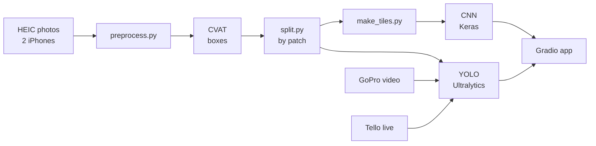

# Architecture

Detect **suppilovahvero** (*Craterellus tubaeformis*) on the forest floor.
1. **CNN:** is there a mushroom? (yes/no)
2. **YOLO:** where is it? (boxes)
3. **Demo:** test photos → GoPro video → live Tello over a terrarium.

## 1. Pipeline



## 2. Data

Taken by hand on 25 Oct 2026, with 2 iPhones. Originals are on the shared drive, **not in git**.

| Source | Photos | With mushroom | Without |
|---|---|---|---|
| Benjamin | 145 | ~125 | ~20 (to confirm) |
| Eddie | 252 | 224 | 28 (`no_mushroom_*`) |
| **Total** | **397** | **~350** | **~48 (~12%)** |

**Videos (test only):**
- **GoPro:** 4 clips, 2.7K at 60 fps (2 with mushrooms, 2 without).
- **Tello:** 2 clips, 720p at 30 fps.

**Watch out:**
- **Mushrooms are often tiny:** handled with tiles and SAHI.
- **Many shots repeat the same patch:** split by patch.
- **Mixed orientation:** apply the EXIF rotation.

## 3. Preprocessing

- **`preprocess.py`:** HEIC → JPG, apply EXIF rotation, ≤1920 px, rename `BE_0001.jpg` / `ED_0001.jpg`, write `metadata.csv` (author, time, GPS, has_mushroom, patch_id).
- **`split.py`:** group photos into patches by time and GPS, then split 70/15/15 **by patch**.
- **M1 deliverable:** `dataset.zip` → `images/`, `annotations/` (VOC), `labels/` (YOLO), `metadata.csv`.

## 4. CNN (M2)

The same simple CNN throughout: 4× [Conv → ReLU → MaxPool] (32-64-128-128) → Dense(128) → sigmoid, at 224×224.

| Step | What | Result |
|---|---|---|
| 1. Baseline | whole photos, no regularization, 30 epochs | low train acc |
| 2. Diagnose | mushrooms are only 2–3 px at 224 | **high bias** |
| 3. Fix | **tiles**: ~500 px squares, "mushroom" if the tile contains a box | train acc ↑ |
| 4. Diagnose | train ≫ val | **high variance** |
| 5. Fix | Dropout + L2 + augmentation | gap ↓ |
| 6. Control | EarlyStopping + ModelCheckpoint → `cnn_best.h5` | |
| 7. Test | Accuracy, Precision, Recall, confusion matrix | |

- **Imbalance:** use `class_weight`.
- **Whole photo:** "mushroom" if **any** tile says so.
- **Extra:** Grad-CAM, showing where the CNN looks.

## 5. YOLO (M3)

- **Model:** `yolov5su.pt` fine-tuned. The live demo uses `yolov5nu`.
- **Config:** `configs/data.yaml`, one class: `suppilovahvero`.
- **Training:** `imgsz=960`, `batch=-1` (RTX 4050), `epochs=100`, `patience=20`.
- **Outputs:** mAP@0.5, P/R, prediction images on the test set.
- **Extras:** SAHI (with vs without), ByteTrack count on GoPro video, and CNN vs YOLO on the same test photos.

## 6. Demo

| # | Input | Shows |
|---|---|---|
| 1 | test photos | CNN tiles + Grad-CAM + YOLO boxes |
| 2 | GoPro video | boxes + "N mushrooms found" |
| 3 | Tello live over terrarium | real-time boxes, finds saved to SQLite |

- **Live:** Tello → laptop over the Tello's Wi-Fi → YOLO on GPU → Gradio. See [drone.md](drone.md).
- **Fallback:** a pre-recorded terrarium flight.
- **Priority if time runs short:** spec items → Grad-CAM → SAHI → ByteTrack → Tello live → finds table.

## 7. Repo

```
app/panel.py        Gradio
configs/data.yaml   YOLO config
docs/               ARCHITECTURE.md, drone.md
src/                preprocess, split, make_tiles, cnn_train, yolo_train, gradcam, tello_fly
models/ results/ report/
pyproject.toml uv.lock
```

## 8. Timeline

| When | What |
|---|---|
| ✅ 25 Oct | photos + GoPro videos |
| ✅ 27 Oct | Tello test flights |
| 1–7 Nov | preprocess, CVAT, split → **M1** |
| 8–21 Nov | CNN → **M2** |
| 15–28 Nov | YOLO + extras → **M3** |
| 22 Nov–2 Dec | Tello live, terrarium, Gradio, rehearsal |
| Week 49 | presentation + report |

## 9. Risks

| Risk | Fix |
|---|---|
| Tiny mushrooms | tiles (CNN), `imgsz=960` + SAHI (YOLO) |
| Same patch in train and test | split by patch |
| Annotation takes long (~8–15 h) | split it across all 5, start early November |
| Benjamin's negatives not labelled | check by hand before splitting |
| Tello camera points forward | fly higher and further back |
| Live demo fails | pre-recorded flight |
