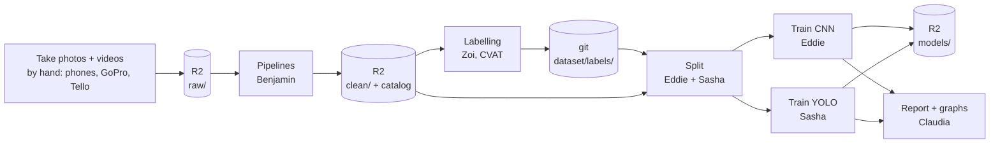
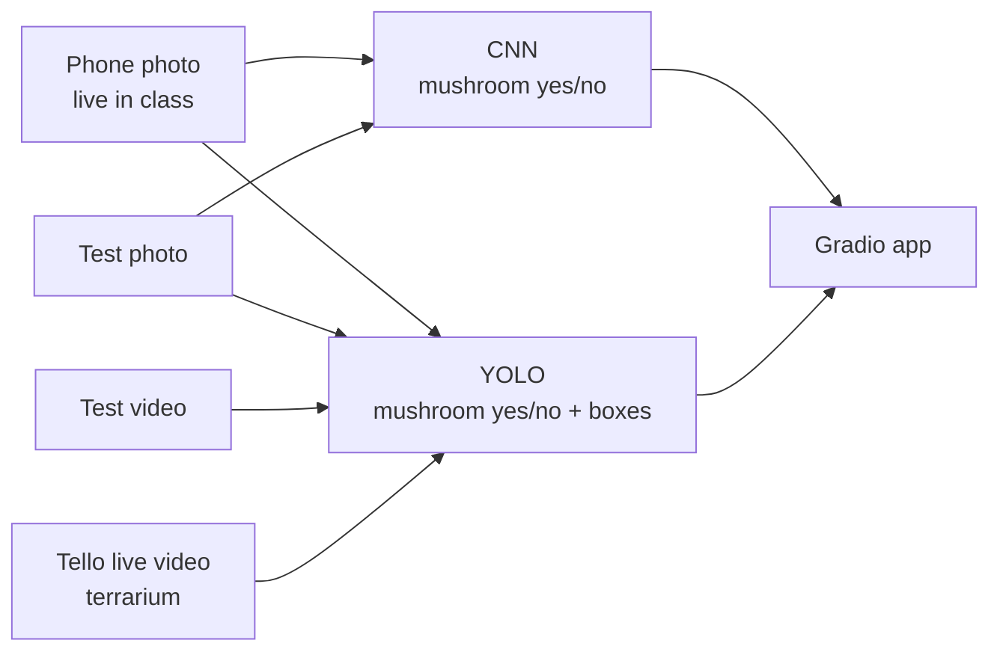

# Architecture

Detect **suppilovahvero** (*Craterellus tubaeformis*) on the forest floor:
- **CNN:** is there a mushroom? (yes/no)
- **YOLO:** is there a mushroom, and if yes, where? (boxes; no boxes = no mushroom)
- **Presentation + live demo:** photos, video, then the Tello over a terrarium.

Two parts: **building** the models, then **running** them in the demo.

### 1. Building (development)

### 2. Running (demo)

## Data

- **R2 bucket `craterellus`:** photos, videos and trained models. Never in git.
  - `raw/`: the originals (locked).
  - `clean/`: the pipeline output that everyone works from. Benjamin will add the cleaned data there.
  - `models/`: trained models.
- **Locally:** `dataset/` and `models/` mirror the bucket (see the README).
- **Git:** code, labels (`dataset/labels/`), the split (`dataset/split.csv`), results and docs.

## Roles

| Who | Part |
|---|---|
| Benjamin | Pipelines + storage |
| Zoi | Labelling + terrarium |
| Eddie | Split + CNN |
| Sasha | Split + YOLO |
| Claudia | Report, comparison, graphs |
| Everyone | Demo: app, drone, live YOLO, presentation|

## Benjamin: pipelines + storage

**Goal:** every photo and video clean, named the same way, sorted and listed in `catalog.csv`, ready for labelling and training.

**Pipelines**
- **Photos:** `raw/` → `clean/photos/{mushroom,no_mushroom}/`
  - HEIC → JPG (quality 95), full resolution
  - upright (EXIF rotation applied)
- **Videos:** `raw/` → `clean/videos/{mushroom,no_mushroom}/`, kept as MP4.
- **Live capture:** save Tello snapshots and recordings into the input folders, so the two pipelines above pick them up.
- **Upload:** `clean/` → R2. Add files, never overwrite or delete.

**Rules**
- **Names:** `YYYYMMDD_HHMMSS_source.jpg` (e.g. `20261025_102835_benjamin.jpg`), in Finnish local time. If two files from the same source have the same timestamp (to the second), add `_2` to the second one, so it doesn't overwrite the first.
- **Source and time**, per `raw/` folder:

| `raw/` folder | Source | Camera | Take the time from |
|---|---|---|---|
| `photos_eddie` | `eddie` | iPhone 14 | EXIF |
| `photos_benjamin` | `benjamin` | iPhone 11 | EXIF (not the file name: that's UTC) |
| `photos_drone` | `drone` | Tello, saved by the phone app | file name (UTC → local); no EXIF time |
| `videos_drone` | `drone` | Tello, phone app recording (1280×720, 30 fps) | video `creation_time` (UTC → local) |
| `videos_mushrooms`, `videos_no_mushrooms` | `gopro` | GoPro HERO7 Black | set by hand: the camera clock says 1 Jan 2016; filmed 25 Oct 2026 |
- **Mushroom or not:** set by a person (the input folder), never by the script. So you can rename yours that are no_mushroom similar to how mine are named.
- **Rerun-safe:** files already in the catalog are skipped.

**Catalog** (`clean/catalog.csv`, one row per file, stored in R2)
- `filename`, `path`, `original_name`
- `source`, `type` (photo/video), `has_mushroom`
- `time`, `lat`, `lon`
- `width`, `height`
- `fps`, `duration` (videos only)

**Local SQLite:** a small script that builds `dataset/catalog.db`, for anyone who wants SQL. It rebuilds the database on every run.
- `catalog.csv` → table `files`
- `split.csv` → table `split` NOT for you to do just saying to you are aware (once me and Sasha have made it) this will come from a script called split.py that me and Sasha will make, like the training/val/test and we will break them apart by patch of mushrooms, hence we need the catalog.csv you will make in order to make group photos according to location and time and who took the photo etc. No need to worry on this. Just make it so the split.csv that will exists locally in the dir dataset/.
- The two (catalog and split csv) are kept apart and joined on `filename` when needed, so a new split never changes the catalog.

**Not Benjamin's job:** the split, patches, boxes. 

**Done when**
- Zoi can open `clean/photos/mushroom/` straight in CVAT.
- Eddie and Sasha can filter `catalog.csv` by source, time, place and label.

**Tools:**
No clue for some of them, these are just suggestions of course.
- `pillow` + `pillow-heif`: photos
- `opencv-python`: video info and recording
- `djitellopy`: Tello stream
- `pandas`: the CSV
- `sqlite3`: the local database
- `rclone`: R2

## Zoi: labelling + terrarium

**Goal:** every mushroom in `clean/photos/mushroom/` has a correct box, and the terrarium is ready for the demo.

**Labelling**
- One label: `suppilovahvero`.
- One tight box per mushroom, including half-hidden ones and each mushroom in a cluster.
- Export in **YOLO format** → `dataset/labels/`, one `.txt` per photo with the same name.
- `no_mushroom` photos need no boxes.
- Write the box rules in `docs/labelling.md`, so everyone can read how you did it, or for project showcase more like.

**Terrarium**
- 1 m × 1 m, with moss, needles, leaves, cones and bark: forest floor plus look-alikes.
- Real or bought suppilovahvero.
- Moss pressed down, so the drone's wind doesn't move it.
- Test it with the Tello early, and record a backup flight.
- You can look at the pictures, I think you will spend a lot of time labelling haha looking at them and I guess you can go to the local forest and make it. Happy to come help, I have an idea of the box we can use.

**Done when**
- Every mushroom photo has a label file.
- Once done, please go through the labels one more time to catch any missed mushrooms or wrong boxes. The models learn straight from these labels, so this step really matters.
- The terrarium is built and a test flight is recorded (probabaly we do the demo like 3 days or so before the real demo)

**Tools**
- **CVAT** (cvat.ai, free): drawing boxes or whatever you like not sure, I've never done this before, YOLO export.
- Optional: AI pre-labels (Grounding DINO) to fix by hand instead of drawing from zero. Theres this fancy tool Grounding DINO that does it for you and then you can check but I think its hard to use, you can take a look.

## Eddie + Sasha: split

**Goal:** one split that both models use, so the CNN and YOLO are tested on the same photos.

- **Save it as `dataset/split.csv`** (filename → train / val / test), in git. It's loaded into the local SQLite as its own table `split`.
- **By patch:** photos taken close in time and place go in the same set, so near-identical shots never end up in both train and test. Use time + GPS from `catalog.csv`.
- **About 70 / 15 / 15**, with mushroom and no_mushroom photos split separately, so every set has both.
- **Decide:** drone footage as test only, or some of it in training.

**Tools:** `pandas`, `scikit-learn` (`GroupShuffleSplit`).

## Eddie: CNN

**Goal:** our own binary Keras CNN (mushroom / no mushroom), trained from scratch.

- **Input:** try several and compare:
  - whole photos
  - grid tiles
  - crops centred on mushrooms, plus empty crops
  Mushrooms are small, so the crops are expected to work best.
- **Baseline:** no regularization.
- **Diagnose:** bias or variance, from the train vs val curves.
- **Regularize:** try the options one at a time and keep what helps:
  - Dropout
  - L2
  - augmentation (flips, rotations, brightness, contrast)
  - BatchNorm (if training stalls)
  - learning rate: lower it, or ReduceLROnPlateau
- **Control:** EarlyStopping + ModelCheckpoint.
- **Imbalance:** class weights.
- **Tuning table:** every run (what changed, train / val / test scores, lesson learned), ending with the best combination as the final model.
- **Test:** accuracy, precision, recall, confusion matrix.
- **Save:** best `.h5` → R2 `models/cnn/`; curves + table → `results/cnn/`.

**Done when:** the tuning table and test scores are in `results/cnn/` and the `.h5` is in R2.

**Tools:** `keras` (on the PyTorch backend for the GPU), `tensorflow` (data loading), `matplotlib`, `scikit-learn` (metrics).

## Sasha: YOLO

**Goal:** a fine-tuned YOLO that finds and boxes suppilovahvero.

- **Data:** YOLO folders from `split.csv` + `clean/photos/` + `dataset/labels/`, and `configs/data.yaml`.
- **Background:** keep the no_mushroom photos as background images.
- **Model:** YOLOv5 pretrained on COCO, fine-tuned to 1 class (required).
- **Try more:** compare in a results table:
  - bigger YOLOv5 sizes: `yolov5su` → `yolov5mu`
  - newer models: YOLOv8, YOLO11
  - My laptop GPU (RTX 4050, 6 GB) fits up to about `m` at image size 960 apparently, so yours can do even better I think.
- **Image size:** large (e.g. 960), since mushrooms are small.
- **Test:** mAP50, mAP50-95, precision, recall, confusion matrix, example predictions.
- **Live demo:** the best model runs on the laptop GPU; the Tello only streams the video. Check that it keeps up with the stream.
- **Save:** `best.pt` → R2 `models/yolo/`; plots + metrics → `results/yolo/`.

**Done when:** the test metrics and plots are in `results/yolo/` and the `.pt` is in R2.

**Tools:** `ultralytics`; optional SAHI (small objects); ByteTrack (built in) for counting mushrooms in video.

## Claudia: report + graphs

**Goal:** the report and the graphs that show what we did and how well it works.

**Graphs**
- **Data:** photo counts per class, source and split.
- **CNN:** training curves, tuning table, confusion matrix.
- **YOLO:** training curves, PR curve, confusion matrix, example detections.
- **CNN vs YOLO:** the same test photos; accuracy, precision, recall, speed.

**Report**
- Task division, active and passive members.
- Challenges, and how teamwork went.
- Methods and results, using the graphs.

**Done when:** the graphs are in `results/` and the report is in `report/`, ready for the presentation.

**Tools:** `pandas`, `matplotlib`.

## Everyone: presentation + demo

**Presentation (Prezi)**
1. The idea and the story behind it.
2. How we did it: data, pipelines, labelling, training.
3. Results: graphs, CNN vs YOLO, how the models were trained.

**Live demo (Gradio)**
1. **Phone photo with a mushroom**, taken in class on a plain background → CNN says "mushroom", then YOLO draws the box.
2. **Phone photo without a mushroom** → CNN and YOLO both say "no mushroom".
3. **One test photo** → CNN, then YOLO.
4. **Test video** → YOLO.
5. **Tello live video** over the terrarium → YOLO.

**Tools:** `gradio`, `djitellopy`, `opencv-python`. Drone setup: [drone.md](drone.md).
