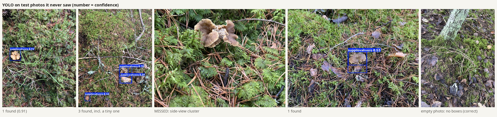
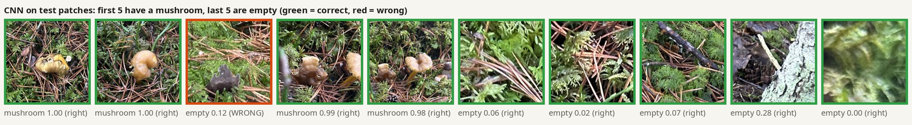
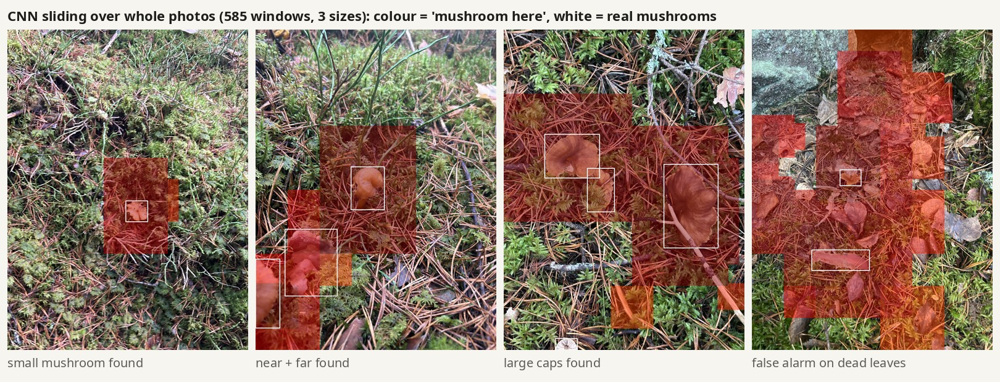

# Quick demo: results

A first end-to-end run (3 Nov 2026, branch `demo_eduard`) to show the idea works on our own photos.
Everything ran on a laptop (RTX 4050) in one evening.

## Data

- **Photos:** 397 (Eddie 252 + Benjamin 145, taken 25 Oct): 351 with mushrooms, 46 without.
- **Split by patch:** photos taken close together go to the same split, so near-identical shots never end up in both train and test.

| Split | Photos | Mushroom boxes |
|---|---|---|
| Train | 285 (251 + 34 empty) | 1,013 |
| Val | 57 (49 + 8 empty) | 128 |
| Test | 55 (51 + 4 empty) | 162 |

## YOLO (M3): where are the mushrooms?

| Metric | Test | Meaning |
|---|---|---|
| mAP50 | **0.67** | overall detection quality (0–1) |
| Precision | **0.67** | 2 of 3 boxes are real mushrooms |
| Recall | **0.61** | finds ~6 of 10 mushrooms |
| mAP50-95 | 0.40 | how tightly the boxes fit |

**How:**
- **Auto-labelling:** Grounding DINO (zero-shot AI) drew the boxes.
  - **Prompt:** `"mushroom. pine cone. dead leaf. bark. stick."`, keeping only *mushroom* boxes. The look-alikes cut false boxes by 88%.
  - **Tiles:** run on overlapping 960 px tiles plus the whole photo, then duplicates merged.
  - **Empty photos:** forced to 0 boxes.
  - YOLO-World was tried first but found only ~1 in 10 mushrooms.
- **Transfer learning:** YOLOv5s pretrained on COCO, with the head replaced by 1 class, `suppilovahvero`.
- **Training:**
  - `imgsz=960` so small mushrooms stay visible.
  - Batch size picked automatically for 6 GB of GPU memory.
  - Augmentation: flips, ±10° rotation, colour and scale jitter, mosaic.
  - EarlyStopping (patience 20): stopped at epoch 50, best at ~30, about 8 minutes.
- **Empty photos (~12%):** kept as background images, to teach it what is *not* a mushroom.



## CNN (M2): is there a mushroom here? (yes/no)

**Network (the same in every run):**
- 4 × [Conv 3×3 → ReLU → MaxPool] (32-64-128-128) → Dense(128) → sigmoid, at 224×224.
- Adam, with class weights.
- Runs on the GPU through Keras 3's PyTorch backend, and still saves as `.h5`.

| # | Version | Train | Val | Test acc | Test P | Test R | Lesson |
|---|---|---|---|---|---|---|---|
| 1 | whole photos | 1.00 | 0.81 | 0.80 | 0.92 | 0.86 | high variance; mushrooms only 2–3 px |
| 2 | 480 px grid tiles | 0.80 | 0.86 | 0.80 | 0.00 | 0.00 | did not learn (loss stuck at ln 2) |
| 3 | tiles + regularization | 0.59 | 0.58 | 0.54 | 0.26 | 0.70 | the data was the problem |
| 4 | mushroom-centred patches | 1.00 | 0.89 | 0.89 | 0.83 | 0.86 | learns, but high variance |
| 5 | patches + BatchNorm, Dropout, L2, augmentation, EarlyStopping | 0.85 | 0.84 | 0.86 | 0.75 | 0.89 | gap closed, stopped too early |
| **6** | **+ patience 15, ReduceLROnPlateau (final)** | **0.91** | **0.88** | **0.94** | **0.89** | **0.92** | **best** |

**What the terms mean:**
- **Grid tiles:** the photo cut into fixed 480 px squares. Mushrooms stayed too small, and some "empty" tiles had mushrooms in them.
- **Patches:** a square centred on each mushroom (~2.5× its size), plus empty squares taken only from places with no mushrooms.
- **Augmentation:** random flips, 90° turns, brightness and contrast, which gives more varied training images.
- **Regularization:**
  - **Dropout:** switches off random neurons during training.
  - **L2:** keeps the weights small.
  - **BatchNorm:** keeps the values stable, so training moves.
- **EarlyStopping + ModelCheckpoint:** stop when validation stops improving, and keep the best model.
- **ReduceLROnPlateau:** lower the learning rate when progress stalls.



### Sliding the CNN over whole photos

585 windows per photo, in 3 sizes (160/256/384 px). Result:
- **92%** of mushrooms land in a flagged window.
- **Many false alarms**, mostly dead leaves: only 42% of flagged windows hold a mushroom.
- **About 1 photo/s.**

So the **drone uses YOLO**, and the sliding CNN is a heatmap view for photos.



## Limits

- **Auto-labels:** all boxes, including the test set's, come from the auto-labeller (~80–85% correct), so the scores are measured against them.
  Hand-check at least the **test photos** in CVAT to make the scores official.
- **YOLO's weak spots:** duplicate boxes on one mushroom, missed clusters seen from the side, and low confidence on small mushrooms.

## Next steps

1. **Fix the labels:** check `dataset/labels_auto/` in CVAT (test set first), then retrain.
2. **YOLO:** stricter box merging, train on 640 px tiles + SAHI, P2 head or `yolov5m`.
3. **CNN:** more hard negatives (leaves, cones, bark), and Grad-CAM heatmaps.
4. **Demo:** GoPro mushroom count (ByteTrack), live Tello in the Gradio app.

## What's where

| In the repo | |
|---|---|
| `src/preprocess.py` | HEIC → JPG, `metadata.csv` |
| `src/autolabel.py` | Grounding DINO draft boxes |
| `src/split.py` | split by patch, YOLO folders |
| `src/make_tiles.py`, `src/make_patches.py` | CNN inputs (v1 tiles, v2 patches) |
| `src/cnn_train.py` | CNN runs: `--version v1 / v2 / v2.1` |
| `src/yolo_train.py` | YOLO fine-tuning + test |
| `src/cnn_sliding.py` | CNN over whole photos |
| `app/panel.py` | Gradio demo |
| `dataset/labels_auto/` | auto-labels (YOLO format) for all 397 photos |
| `dataset/metadata.csv` | per photo: author, time, GPS, patch, split |
| `results/` | tuning tables, curves, YOLO plots, example images |
| `configs/data.yaml` | YOLO dataset config |

**Not in git (too big):** photos and trained models (`best.pt` 18 MB, `cnn_best.h5` 3 MB). These are on the external drive (`DL_project/work/`) and will go to the shared drive / a GitHub Release.

**Rerun everything** (photos in `data/images_all/`, with `images_all_mapping.csv` next to the folder):
```bash
W=path/to/work
uv run src/preprocess.py --src data/images_all --mapping data/images_all_mapping.csv --out $W
HF_HOME=$W/../hf_cache uv run --with transformers src/autolabel.py --work $W
uv run src/split.py --work $W
uv run src/make_patches.py --work $W
uv run src/yolo_train.py --work $W
uv run src/cnn_train.py --work $W --version v2.1
```
